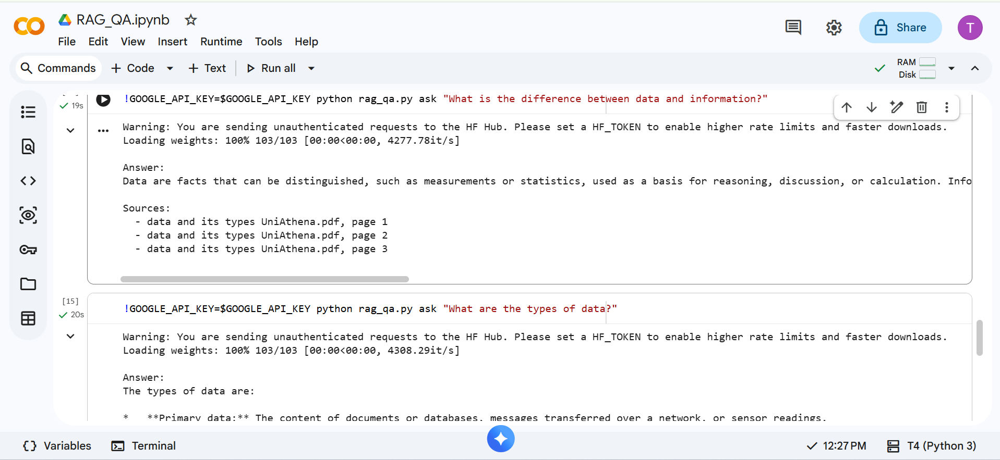
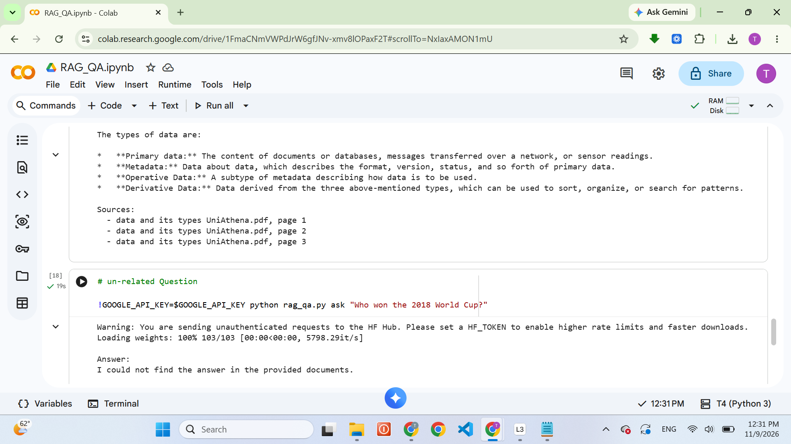

# Document Q&A Assistant with RAG & Vector Embeddings

A Retrieval-Augmented Generation (RAG) system that answers questions **strictly from your own PDF/text documents** and cites the **source file and page number**.

## Architecture

```
PDF/TXT -> Loader -> RecursiveCharacterTextSplitter -> Embeddings (MiniLM) -> ChromaDB
                                                                                |
 Question -> Embedding -> Top-k similarity search -> RetrievalQA (LLM) -> Answer + page citations
```

| Stage | Tool |
|---|---|
| Loading | LangChain `PyPDFLoader` / `TextLoader` |
| Chunking | `RecursiveCharacterTextSplitter` (1000 chars, 200 overlap) |
| Embeddings | `sentence-transformers/all-MiniLM-L6-v2` (local, free) |
| Vector store | ChromaDB (persistent) |
| QA chain | LangChain `RetrievalQA` with a grounded prompt |
| LLM | OpenAI, Ollama, or none (extractive fallback) |

## Setup

```bash
python -m venv venv
venv\Scripts\activate          # Windows  (Mac/Linux: source venv/bin/activate)
pip install -r requirements.txt
```

Put your PDFs in `documents/`, then:

```bash
python rag_qa.py ingest
python rag_qa.py ask "What is the main topic of the document?"
python rag_qa.py chat
```

### Choosing an LLM
Copy `.env.example` to `.env` and set one:
- `GOOGLE_API_KEY=...` for Google Gemini (free tier). Default model: `gemini-3.1-flash-lite`. Override with `GEMINI_MODEL=<model-name>`. Note: Gemini 2.5 models were retired by Google in October 2026, so use a Gemini 3.x model.
- `OPENAI_API_KEY=...` for OpenAI (gpt-4o-mini)
- `USE_OLLAMA=1` for a free local model (install Ollama, run `ollama pull llama3.2`)
- Nothing: returns the most relevant passages with page citations

## How answers stay grounded
The prompt instructs the model to use only the retrieved context and to reply
*"I could not find the answer in the provided documents."* otherwise. Each answer lists the
source file and page number of the chunks used.

## Example output

Question: *What is the difference between data and information?*



Question outside the document (answer is not hallucinated):



## Configuration (env vars)
`CHUNK_SIZE`, `CHUNK_OVERLAP`, `TOP_K`, `EMBED_MODEL`, `DOCS_DIR`, `DB_DIR`
